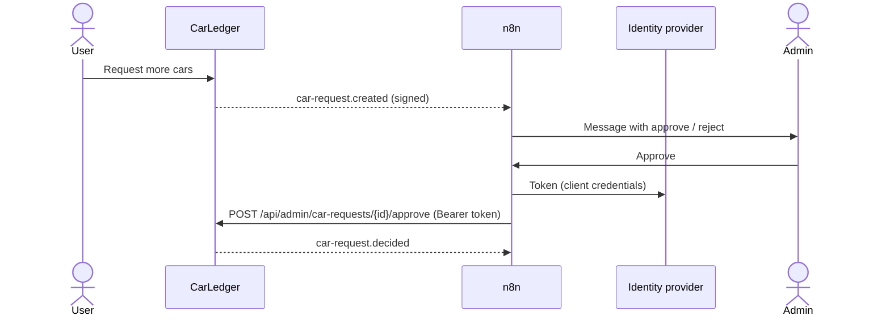

# Approving car requests with n8n

When a user requests more cars, CarLedger sends the webhook `car-request.created` (see [WEBHOOKS.md](WEBHOOKS.md)).
[n8n](https://n8n.io) can turn it into a message with *Approve* and *Reject* on any channel (e-mail, Telegram, Matrix,
ntfy …) and call the admin API of CarLedger with the answer. n8n is optional and not part of the CarLedger chart:
without it, the administrators decide on the administration page.



n8n calls CarLedger as a **service account**: an OpenID Connect client of its own, whose tokens carry the role
`admin`. CarLedger accepts such an access token in the header `Authorization: Bearer …` for every API path; the
browser keeps logging in as before.

## 1. Service account

### Keycloak

In the admin console of the realm `car-ledger`:

1. **Clients → Create client**, client id `car-ledger-n8n`, OpenID Connect.
2. **Capability config**: *Client authentication* on, *Standard flow* and *Direct access grants* off,
   *Service accounts roles* on.
3. **Service accounts roles** tab of the client → *Assign role* → filter by realm roles → `admin`.
4. Copy the client secret from the **Credentials** tab.

Check it from a shell:

```bash
TOKEN=$(curl -s https://keycloak.example.com/realms/car-ledger/protocol/openid-connect/token \
  -d grant_type=client_credentials -d client_id=car-ledger-n8n -d client_secret="$SECRET" | jq -r .access_token)
curl -H "Authorization: Bearer $TOKEN" "https://car-ledger.example.com/api/admin/car-requests?state=OPEN"
```

Requests decided by n8n show `service-account-car-ledger-n8n` as the deciding administrator.

### authentik

authentik issues tokens for a service account with the `client_credentials` grant of the CarLedger provider, with the
user name of the service account and an app password (not tested with this repository yet, check the
[authentik documentation](https://docs.goauthentik.io/add-secure-apps/providers/oauth2/client_credentials/) of your
version):

1. **Directory → Users → New service account**, user name `car-ledger-n8n`.
2. Add the service account to the group `admin` (the groups are the roles of CarLedger).
3. **Directory → Tokens and App passwords → Create**: user `car-ledger-n8n`, intent *App password*; copy the key.
4. Token request: `grant_type=client_credentials`, `client_id` of the provider *CarLedger*,
   `username=car-ledger-n8n`, `password=<app password>`, `scope=openid profile` (the scope `profile` adds the claim
   `groups`). The token endpoint is `https://authentik.example.com/application/o/token/`.

## 2. Webhook

Point the webhook of CarLedger to the production URL of the n8n workflow and share a secret (see
[WEBHOOKS.md](WEBHOOKS.md)):

```yaml
carLedger:
  webhook:
    url: https://n8n.example.com/webhook/car-ledger
    existingSecret: car-ledger-webhook
    events: [car-request.created]
```

## 3. Workflow

[n8n/car-requests.json](n8n/car-requests.json) is an example to import (*Workflows → Import from file*). It has not
been run against a real n8n yet, check every node after the import:

1. **Webhook**: `POST /webhook/car-ledger`, option *Raw Body* on, so the signature can be checked over the exact body.
2. **Verify signature** (Code): computes the HMAC-SHA256 of the raw body with the secret and drops events with a wrong
   signature or of another type. It needs the module `crypto` (`NODE_FUNCTION_ALLOW_BUILTIN=crypto` for n8n) and the
   secret in the environment variable `CARLEDGER_WEBHOOK_SECRET` of n8n.
3. **Ask the admin** (Send and Wait for Response): a message with the account, the number of cars and the reason, and
   the buttons *Approve* and *Reject*. The example uses e-mail; every channel with *Send and Wait for Response* works.
4. **Approved?** (If): decides which endpoint is called.
5. **Approve** / **Reject** (HTTP Request): `POST https://car-ledger.example.com/api/admin/car-requests/{requestId}/approve`
   with the body `{}` (the limit becomes the current one plus the requested cars), or `…/reject` with
   `{ "comment": "Rejected in n8n" }`. Authentication: an *OAuth2 API* credential with the grant type
   *Client Credentials*, the token endpoint of the identity provider, the client id and secret of the service account
   (for authentik: see above, the user name and app password go into the token request).

A request decided on the administration page in the meantime answers `409`, the workflow can ignore it.
